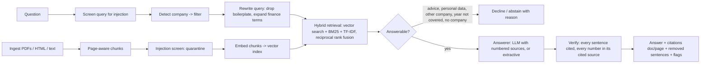

# Design notes

## Pipeline

## Decisions

| Decision | Why | Trade-off |
|---|---|---|
| Hybrid retrieval: vector search + BM25 + TF-IDF | Embeddings match related wording; keywords match exact line items and tickers, which financial questions are full of | Three signals to tune; fused by rank so their scales don't matter |
| LSA embeddings by default, neural models pluggable | LSA runs anywhere with no model download, so the build and CI are reproducible; `st:` and `openai:` embedders use the same interface | LSA is a weak embedding; on held-out it adds little over keywords |
| Exact vector index in numpy, vectors cached on disk | A few thousand chunks search in under a millisecond; model vectors are computed once at ingest and reused if the chunks and model match | Needs FAISS or a vector database at much larger scale |
| Company detection used as a hard filter | 10-K text is highly repetitive across companies; filtering is the single largest retrieval gain (see below) | Questions that compare companies need both names |
| Query rewriting with a finance glossary | Analysts ask about "quick ratio" or "capex"; filings say "accounts receivable" and "purchases of property, plant and equipment" | Glossary was written against the dev set, so dev scores are optimistic; held-out shows the real gain |
| Page-aware chunks (350 words, 70 overlap) | Citations must point to a page a person can check | Sweep below; 1-question differences on 26 questions are noise |
| Abstain before calling a model | Cheap, explainable refusals for advice, personal data, uncovered companies and years | Rules, not understanding; an LLM still abstains on the rest |
| Verify after generation | The model is asked to cite, but the code checks it: uncited sentences and numbers not in the cited source are removed | Calculated figures pass only if the sentence shows the calculation |
| Primary sources only by default | Filings are trusted; broker notes, blogs and web pages are where injected text comes from | Secondary sources must be explicitly allowed |

## Retrieval ablation (page-level; all rows use the company filter and query rewrite unless stated)

| Method | Dev hit@1 | Dev hit@3 | Dev hit@6 | Dev MRR | Held-out hit@6 | Held-out MRR |
|---|---|---|---|---|---|---|
| BM25 only | 0.269 | 0.462 | 0.654 | 0.400 | 0.400 | 0.180 |
| TF-IDF only | 0.308 | 0.500 | 0.577 | 0.404 | 0.333 | 0.122 |
| Vector only (LSA) | 0.346 | 0.423 | 0.577 | 0.418 | 0.333 | 0.156 |
| Keyword (BM25 + TF-IDF) | 0.269 | 0.538 | 0.654 | 0.407 | 0.400 | 0.183 |
| **Hybrid (vector + BM25 + TF-IDF), default** | **0.308** | **0.500** | **0.654** | **0.429** | **0.400** | **0.127** |
| Hybrid, no filter, no rewrite | 0.077 | 0.231 | 0.231 | 0.135 | 0.133 | 0.044 |
| Hybrid + company filter, no rewrite | 0.115 | 0.231 | 0.308 | 0.183 | 0.400 | 0.150 |

Dev: 26 questions on 4 filings. Held-out: 15 questions on 5 other filings, not looked at during
development. The default was picked on dev (best MRR). Held-out shows that the LSA vectors do not
improve on keyword search there, and that the query rewrite was partly fitted to the dev questions.
With 15 held-out questions, one question moves hit@6 by 0.067.

## Chunk size sweep (dev set, hybrid + filter + rewrite)

Measured before embeddings were added, with keyword retrieval (BM25 + TF-IDF) + filter + rewrite.

| Words / overlap | Chunks | hit@3 | hit@6 | MRR |
|---|---|---|---|---|
| 120 / 30 | 5,185 | 0.423 | 0.538 | 0.341 |
| 180 / 40 | 3,453 | 0.462 | 0.577 | 0.372 |
| 250 / 50 | 2,564 | 0.538 | 0.654 | 0.426 |
| **350 / 70** | **1,849** | **0.538** | **0.654** | **0.407** |
| 500 / 100 | 1,477 | 0.577 | 0.692 | 0.437 |

350 words keeps citations to roughly half a page while matching the larger sizes within one question.

## Extractive answerer: abstention threshold (dev set)

`min_overlap` is how many query terms a passage must share to be quoted.

| min_overlap | False abstentions on 26 answerable | Correct abstentions on 10 unanswerable |
|---|---|---|
| 2 | 0 | 7 |
| **3** | **4** | **9** |

The default favours not answering over quoting an off-topic passage.

## Why FinanceBench is hard for this design

Most FinanceBench questions need a figure from a financial table and a calculation (ratios,
margins, year-on-year changes). PDF text extraction flattens tables into long runs of numbers, which
hurts both lexical retrieval and extractive answering. Practical next steps, in order of expected gain:

1. Table-aware parsing (keep row labels with their values).
2. A neural embedding model in place of LSA, plus a cross-encoder re-ranker.
3. An LLM answerer that is allowed to calculate, with the calculation shown and verified.
